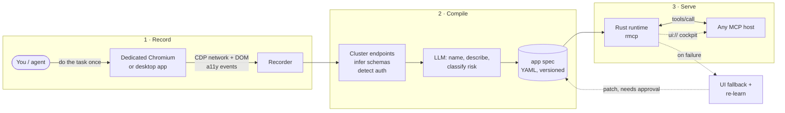
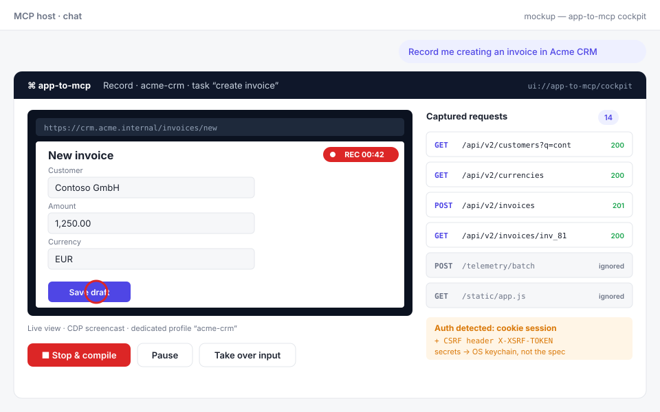
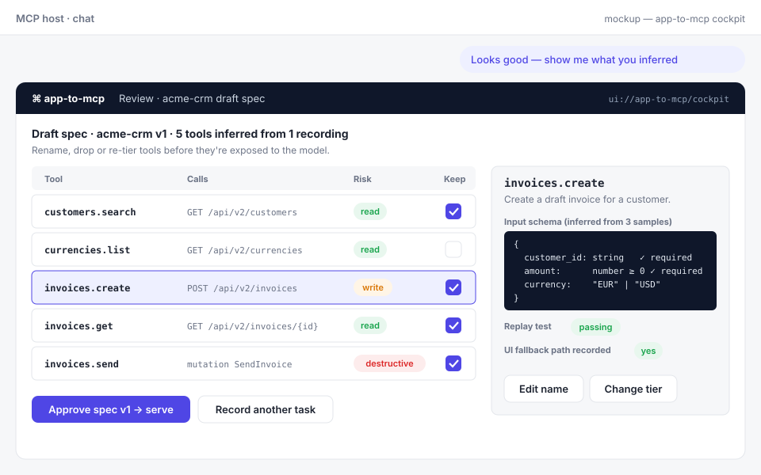
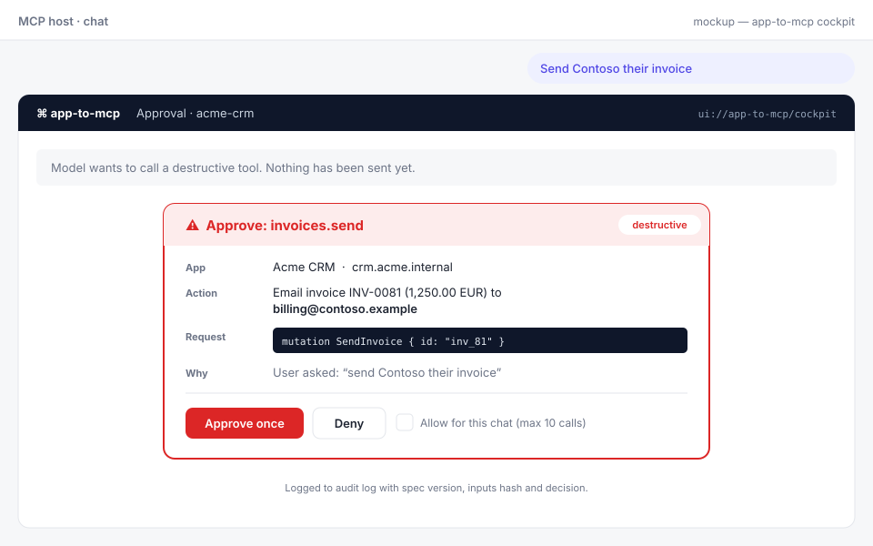
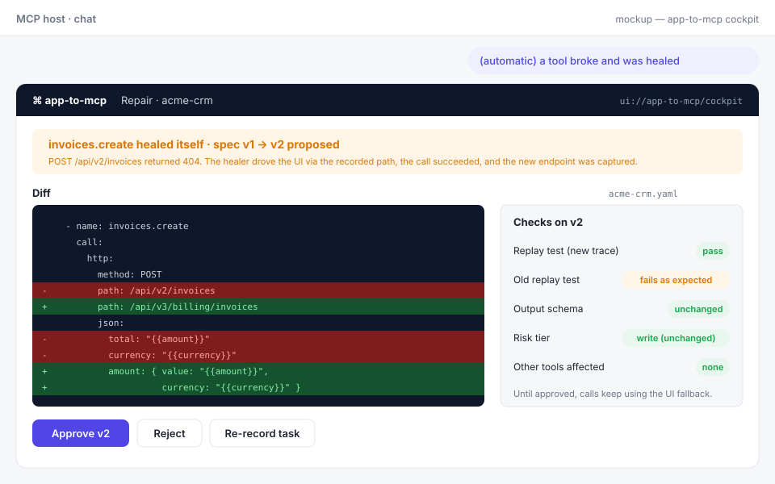

# app-to-mcp

> Show it an app once, get a typed MCP server for it.

**Status:** M0 workspace skeleton (Rust scaffolding). Roadmap: [`app-to-mcp` issues](https://github.com/xoriors/experimental/issues?q=label%3Aapp-to-mcp).

Most apps have no MCP server. Today an agent works with them by computer use: take a screenshot, have a vision model read it, guess where to click, repeat. Each step takes seconds and burns tokens, and it breaks whenever the layout changes.

`app-to-mcp` is a **compiler**. You (or an agent) do a task in the app once while it records. It turns what it saw into a versioned **app spec**: tools with names, input/output schemas and how to call them. A small Rust runtime then serves that spec as an ordinary MCP server, so Claude, Cursor, Codex or any other MCP client gets tools such as `invoices.create(customer, amount)` that run in milliseconds and need no screenshots.

| Source | How it records | How the generated tool runs |
| --- | --- | --- |
| Web apps | CDP network capture in a dedicated Chromium profile | Calls the app's internal HTTP / GraphQL API directly |
| Electron apps | Same as web, via `--remote-debugging-port` | Same as web |
| Native desktop apps | Accessibility tree (AX / UI Automation / AT-SPI) | Replays stable element paths |
| Anything else | Screenshots + vision | Fallback only |

When a call breaks, the runtime falls back to driving the UI, learns the endpoint again and proposes a patch. The patch only applies once a person approves it in the **cockpit**, an [MCP App](https://modelcontextprotocol.io/docs/extensions/apps) rendered inside the chat.

More diagrams: [`docs/architecture.md`](./docs/architecture.md) · Spec example: [`docs/spec-example.yaml`](./docs/spec-example.yaml)

## Cockpit mockups

| Record | Review tools |
| --- | --- |
|  |  |
| **Approve action** | **Repair diff** |
|  |  |

## Planned stack (Rust)

- MCP: [`rmcp`](https://github.com/modelcontextprotocol/rust-sdk), plus the ext-apps `_meta.ui.resourceUri` convention for the cockpit
- Web: `chromiumoxide` (CDP)
- Desktop: `uiautomation` (Windows), `atspi` (Linux), `objc2` + AX (macOS); `enigo`, `xcap`
- Secrets: the OS keychain via `keyring`. Specs never hold credentials.

## Scope and limits

Aimed at internal tools, B2B apps and the user's own accounts. Not a scraper. Respect each site's terms of service. Screen and page content is treated as untrusted input (prompt injection), and destructive tools need an explicit approval.

## Development
    cd app-to-mcp
    cargo fmt --all -- --check
    cargo clippy --workspace --all-targets -- -D warnings
    cargo test --workspace
    cargo run -p app-to-mcp -- --help