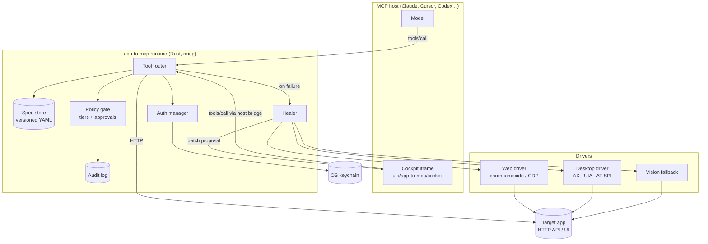
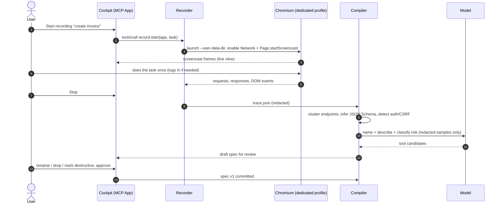
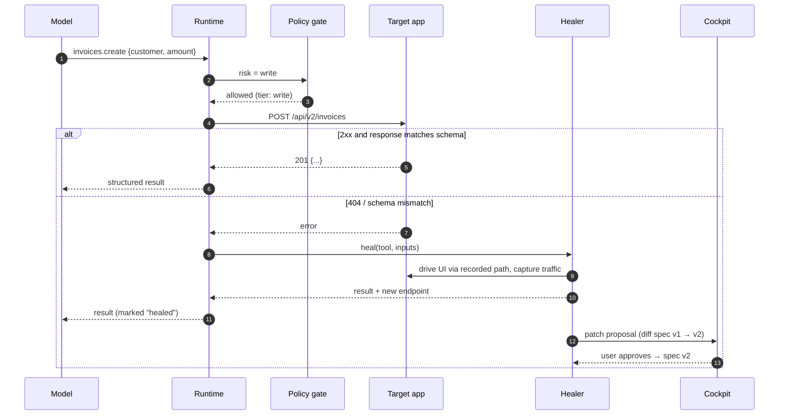
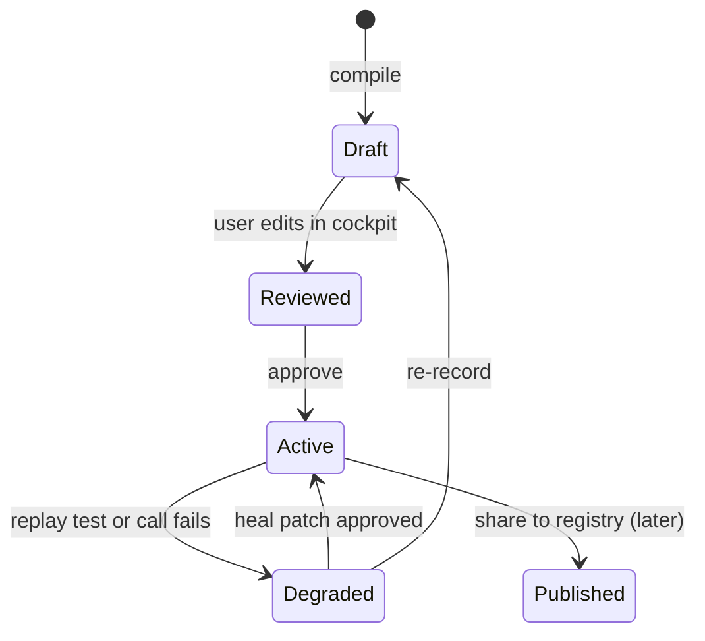

# app-to-mcp architecture

## Components

## Record → compile

## Runtime call and self-healing

## Spec lifecycle

## Risk tiers

| Tier | Example | Default policy |
| --- | --- | --- |
| `read` | list invoices | auto |
| `write` | create a draft | auto, logged |
| `destructive` | delete, send, pay | approval card in the cockpit, every call |
| `blocked` | banking, password managers | never exposed |
