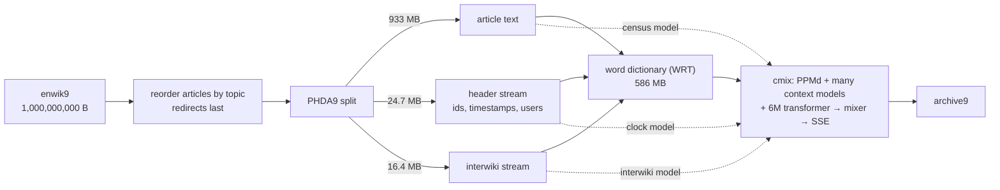

# hutter-prize

Ideas for beating the [Hutter Prize](http://prize.hutter1.net/) record, and a Rust workbench that measures them on enwik9.

The prize pays for compressing `enwik9`, the first 10⁹ bytes of a 2006 English Wikipedia dump, into the smallest *compressor + self-extracting archive*. You get one CPU core for about 50 hours, 10 GB of RAM and no GPU, and each new record must beat the previous one by at least 1%.

> **Status:** research and measurements, not a submission. Numbers marked *measured* come from the workbench in this directory. Everything else is an estimate, and the text says so.

## TL;DR

- **The bar.** The record is **100,424,672 bytes** (fx2-cmix-T, July 2026). The next award needs **S < 99,420,425**, so there is about **1.0 MB** to find. The payout is 500,000 € × (1 − S/L), at least 5,000 €.
- **What changed in 2026.** fx2-cmix-T replaced cmix's small online LSTM with a **6M-parameter transformer trained offline on enwik9** (26 h on 8 RTX 5090s) and shipped its 4-bit weights inside both programs. That alone took 7.5% off, and it changed the economics of everything that follows:
  1. **Stored knowledge is paid for twice.** The weights sit in the compressor *and* in the archive: 2 × 2.93 MB = 5.86 MB, or 5.8% of the total. One bit per weight is worth 1.47 MB.
  2. **The time budget is still full.** The transformer runs about 25 h on its authors' machine (154.7 µs per byte of the 586M-byte preprocessed stream). That is roughly what the LSTM it replaced used to take.
- **So the cheapest bytes left are knowledge the transformer cannot reach.** I built three side models for it, measured them on the record holder's own stream layout, and checked each one with an encode/decode round trip:

| idea | the knowledge | saved, proxy model (measured) | conservative estimate against the record |
|---|---|---:|---:|
| [Revision ids are a clock](#31-revision-ids-are-a-clock) | MediaWiki numbers revisions with one wiki-wide counter: a timestamp interpolates between neighbouring revisions (median error 2.5 s), and pre-2005 revision ids grow with the page id | 469 KB | ~316 KB |
| [Interwiki links name the article](#32-interwiki-links-name-the-article) | the record holder's PHDA9 step moves every interwiki block away from its article; 36% of foreign titles are the English title verbatim | 679 KB | ~253 KB |
| [Census arithmetic](#33-census-arithmetic) | 36,494 Rambot articles print km² then mi², densities that are counts divided by land area, and shares that sum to 100 | 254 KB | ~128 KB |
| **total** | | **1.40 MB (1.40% of S)** | **~697 KB (0.69% of S)** |

These cost seconds of CPU and no stored weights, and they are orthogonal to the transformer. Two of them also work as plain reversible transforms that any compressor benefits from (−449 KB and −318 KB on the proxy). The rest of the way to 1% is to merge the other two 2026 records into the transformer build, then spend the weight tax and the time budget better ([section 4](#4-ideas-that-need-gpus-or-a-50-hour-run)). There is a [step-by-step plan](#6-a-plan-for-the-next-award) at the end.

## 1. The target in numbers

**Rules** ([hrules.htm](http://prize.hutter1.net/hrules.htm)): S = |comp9.exe zipped| + |archive9.exe|. Each program must run in under 70,000 / T hours, where T is the machine's single-core Geekbench 5 score. On the committee's Intel i7-1165G7 (T ≈ 1427) that is **49 h**, which works out to **177 µs per byte of enwik9**. Limits are 10 GB of RAM and 100 GB of disk, with no GPU. A record needs a gain of at least 1%, and pays 500,000 € × (1 − S/L).

**Records** since the prize grew tenfold in 2020:

| date | entry | S (bytes) | gain | what it added |
|---|---|---:|---:|---|
| 2019 | phda9 1.8 | 116,673,681 | baseline | PHDA9 Wikipedia transform, English dictionary |
| 2021 | starlit | 115,352,938 | 1.13% | article reordering by topic |
| 2023 | fast cmix | 114,156,155 | 1.04% | cmix sped up to fit the time limit |
| 2024 | fx-cmix | 112,578,322 | 1.38% | fxcm text models |
| 2024 | fx2-cmix | 110,793,128 | 1.59% | further model and preprocessing work |
| Jun 2026 | cmix-lex | 109,671,639 | 1.01% | sorted header tail + side data, fxcm_v26 |
| Jul 2026 | cmix-obias | 108,521,870 | 1.05% | +76% CPU speed, bigger LSTM, 23 KB offline-trained correction head |
| Jul 2026 | **fx2-cmix-T** | **100,424,672** | **7.46%** | **offline-trained 6M transformer replaces the LSTM** |

fx2-cmix-T was built on fx2-cmix, not on cmix-lex or cmix-obias. Its writeup says it changed nothing else apart from three bug fixes, so the other two 2026 records are still unmerged ([section 4.1](#41-merge-the-2026-records)).

## 2. How the record holder works



The stream sizes in the diagram are *measured*: `hutter-lab streams` rebuilds this layout from enwik9 using the record holder's article order. The 586 MB figure is cmix-lex's report of the stream after the word dictionary.

- **Reordering.** The 172,277 articles in its 1 MB order list come first, in topic order. The remaining 71,148 pages, essentially all redirects, follow in file order. The decompressor restores the original order by sorting on page id.
- **PHDA9.** Each page's header (page id as a delta, revision id, timestamp as `YY` + day index + `:` + second of day, contributor) goes to a *header stream*. Each article's trailing interwiki block goes to an *interwiki stream*. Both are appended after all the text. This is good for local statistics. It also means that when a model codes `[[de:…]]`, the article it belongs to is hundreds of megabytes back.
- **The transformer.** It has 6M parameters, with 75% Kimi-linear-attention layers, a 1,024-byte sliding window and byte tokens. It also gets PPMd's distribution as an input. It is trained offline for 592 epochs, with weights quantized to 4 bits (3.786 bits each after their own entropy coder: the 15 levels are used almost uniformly) and activations to 8 bits. Its cross-entropy is 0.911 nats per byte, against 1.23 for the old LSTM. On its own that would code the stream in about 96 MB, and the full mixture gets about 93 MB. It sees one article at a time.
- **Where S goes.** It is roughly 93 MB of coded payload, plus 2 × 2.93 MB of weights, plus about 1 MB of binaries, dictionary and article order.

## 3. Three ideas, measured

Every experiment runs the same context-mixing model (lpaq-class, my own, in [`src/cm.rs`](src/cm.rs)) twice over the same stream: once plain, and once with a side model plugged into its mixer. The side model sees only bytes already coded, plus what the real decoder would already hold. The difference in coded size is the gain, broken down by region of the stream. `--verify` encodes and then decodes with the side model, which proves it uses no future information. All three runs below were verified.

### 3.1 Revision ids are a clock

Two facts about how MediaWiki numbered revisions, both *measured* on all 243,425 pages:

- **Pre-migration pages.** 87,813 pages (36%) were last edited before the MediaWiki 1.5 migration of June 2005, and have revision ids below 17,000,000. The migration renumbered their revisions **in page-id order**: across all 87,812 adjacent pairs, the revision id strictly increases with the page id, with a median gap of 2. So the revision id can be interpolated from the nearest pre-migration pages already seen.
- **Post-migration pages.** After the migration, revision ids count edits across the whole wiki. The timestamp is therefore a monotone function of the revision id. Interpolating between the nearest revisions the decoder has seen so far, in the record holder's order, gives a **median error of 2.5 s**, with 90% of pages within 24 s. With every page known the median is 1.5 s.

A context mixer cannot interpolate, and in the record holder's stream the page id is only a delta from a page on another topic. The side model ([`src/side/header.rs`](src/side/header.rs)) turns an interpolated value plus an adaptive Laplace spread into a distribution over the next digit. For the timestamp it uses interval masses through the `YY D:S` spelling.

*Measured* on the 24,698,753-byte header stream, in the record holder's order:

| region | raw bytes | plain proxy | with the clock model | saved |
|---|---:|---:|---:|---:|
| page id delta | 1,219,825 | 264,026 | 265,222 | −1,196 |
| revision id, pre-migration | 1,053,756 | 110,153 | 16,513 | **93,640** |
| revision id, post-migration | 1,867,344 | 458,561 | 451,807 | 6,754 |
| timestamp of a pre-migration page | 1,895,693 | 224,867 | 224,164 | 703 |
| timestamp date, post-migration | 2,364,275 | 130,980 | 4,379 | **126,600** |
| timestamp seconds, post-migration | 911,031 | 324,791 | 92,431 | **232,360** |
| username / ip | 4,484,070 | 467,280 | 464,297 | 2,984 |
| user id | 1,869,722 | 79,567 | 72,124 | 7,442 |
| tags and other lines | 9,033,037 | 13,768 | 13,769 | −1 |
| **total** | **24,698,753** | **2,073,993** | **1,604,706** | **469,287 (22.6%)** |

The round trip coded the stream into 1,604,712 bytes and decoded it identically. The gain sits in exactly the two places the facts point to. Everything else is untouched. The saving is robust. In plain file order it is −453 KB, so it does not depend on the record holder's article order, and with four times the table memory it is −467 KB.

### 3.2 Interwiki links name the article

*Measured:* 657,670 interwiki links on 89,491 articles, 14.4 MB in total. **36% of foreign titles are the English title verbatim**, because names, years and places stay the same. Many more share a long prefix ("Anarchism" becomes "Anarchismus", "Anarchisme", and after a re-alignment "Anarquismo").

After PHDA9, the English title is in the main stream and the interwiki block is about 900 MB later. The decoder still knows which article each block belongs to: an article whose text lacks `</text>` had its block moved, and blocks keep article order. The side model ([`src/side/lang.rs`](src/side/lang.rs)) is given those titles. It predicts each foreign title as an aligned copy of the English title or of an earlier title in the block. When the copy breaks, it re-synchronises on the longest typed suffix that occurs in the source. Two extra hashed contexts let the mixer learn per-language spelling patterns.

*Measured* on the 16,380,836-byte interwiki stream:

| region | raw bytes | plain proxy | with the interwiki model | saved |
|---|---:|---:|---:|---:|
| `[[code:` and `]]` | 4,856,981 | 347,673 | 325,103 | 22,570 |
| first title in a block, = English title | 433,145 | 152,558 | 6,202 | **146,356** |
| first title in a block, other | 1,174,137 | 319,085 | 226,347 | **92,738** |
| later titles, = English title | 1,697,176 | 173,947 | 13,255 | 160,692 |
| later titles, other | 6,234,065 | 1,428,356 | 1,173,790 | 254,566 |
| other lines | 1,985,332 | 222,511 | 220,561 | 1,949 |
| **total** | **16,380,836** | **2,644,130** | **1,965,258** | **678,872 (25.7%)** |

The round trip coded the stream into 1,965,262 bytes and decoded it identically. The first title of a block is where the record holder pays full price, because nothing in its context window contains the English title. Later titles in a block can be copied from the block itself, which a transformer does well, so those savings transfer less. In plain file order the saving is −699 KB.

### 3.3 Census arithmetic

In 2002 "Rambot" generated US-place articles from census tables: 36,494 of them in enwik9, 143 MB (14%), and their numbers are tied by arithmetic that neither a context mixer nor a 6M byte-level transformer can carry out:

- every area is printed in km² and then in mi² (÷ 2.589988), and some articles use the reverse order;
- every density is printed per km² and then per mi²;
- population and housing densities are counts printed earlier, divided by the land area printed earlier still. Combining the km² and mi² spellings of the area narrows its true value;
- "the total area is P% water" is water ÷ total;
- the last share in the racial-makeup and age lists is 100 minus the others.

The side model ([`src/side/census.rs`](src/side/census.rs)) parses the article as it is coded and keeps its facts (population, housing units, area intervals). Where a sentence reaches a derived number, it offers a few candidate spellings. Candidate classes (exact rounding, one unit off, another precision) learn their own hit rates.

*Measured* on the 143,085,382 bytes of census articles:

| derived number | raw bytes | plain proxy | with the census model | saved |
|---|---:|---:|---:|---:|
| area in mi² (from km², or the reverse) | 294,350 | 54,515 | 7,254 | 47,261 |
| density per mi² (from per km²) | 348,706 | 105,638 | 53,102 | 52,536 |
| population density (count ÷ land area) | 155,927 | 59,214 | 26,617 | 32,597 |
| housing density (count ÷ land area) | 142,970 | 52,707 | 21,376 | 31,331 |
| water % (water ÷ total area) | 56,534 | 17,652 | 7,624 | 10,028 |
| last racial share (100 − others) | 143,975 | 37,802 | 7,171 | 30,631 |
| last age share (100 − others) | 140,872 | 36,201 | 7,036 | 29,165 |
| all other text | 141,802,048 | 9,359,184 | 9,338,261 | 20,923 |
| **total** | **143,085,382** | **9,722,912** | **9,468,440** | **254,472 (2.6%)** |

The round trip coded the stream into 9,468,453 bytes and decoded it identically. Of the 233,549 bytes saved on derived numbers, 70,363 are on first digits and 163,186 on the rest.

Per-mi² densities resist: 53 KB remain. Only about 15% equal the per-km² density × 2.589988 after rounding, and only 17–27% equal the count divided by the printed area. Rambot evidently used precise areas from separate tables, so these digits carry real information.

### 3.4 How much survives against the real thing

The proxy model is far weaker than cmix plus the transformer. A strong model already spends fewer bits on some of these bytes, so the proxy's savings are an upper bound. For each region I asked whether the record holder can get at the information at all, and applied a transfer factor. **These factors are my judgment, not measurements.** The reasoning is in the table, so you can substitute your own.

| region | proxy saving | can the record holder already get it? | factor | estimate |
|---|---:|---|---:|---:|
| seconds of post-migration timestamps | 232 KB | no: needs interpolation between other pages' (revision, time) pairs scattered over the stream | 0.9 | 209 KB |
| date part of post-migration timestamps | 127 KB | partly: a transformer trained 592 epochs can learn revision → date from the line above | 0.25 | 32 KB |
| pre-migration revision ids | 94 KB | no: needs the absolute page id, and the stream only has deltas. Its models do see the increasing ids of the redirects at the end | 0.8 | 75 KB |
| first title in a block = English title | 146 KB | no: the English title is ~900 MB back. It may memorise famous ones | 0.85 | 124 KB |
| first title in a block, other | 93 KB | mostly no: needs the English title | 0.5 | 46 KB |
| later titles = English title | 161 KB | yes: in-block copy is what attention does best | 0.15 | 24 KB |
| later titles, other | 255 KB | largely: in-block copy and spelling patterns | 0.2 | 51 KB |
| language codes | 23 KB | largely: the code order is learnable | 0.3 | 7 KB |
| census numbers, first digit | 70 KB | partly: leading digits of a conversion are learnable | 0.2 | 14 KB |
| census numbers, other digits | 163 KB | no: trailing digits need real arithmetic | 0.7 | 114 KB |
| side effects elsewhere | 40 KB | not counted | 0 | 0 |
| **total** | **1,403 KB** | | | **697 KB ≈ 0.69% of S** |

Even the conservative column is most of the way to the 1% threshold, from three small models. Real numbers need a 50-hour run of the record holder's code with these models added.

### 3.5 Two ways to ship them

1. **As cmix byte models (the full gain).** cmix already has a `ByteModel` interface: a model that outputs a distribution over the next byte, which the predictor turns into bit predictions. That is exactly the shape of these side models. They have to read through the word dictionary transform (decode codewords on the fly), and the interwiki one needs the per-block English titles from the main stream. The transformer needs no retraining.
2. **As reversible transforms (the quick version).** Rewrite the tail between PHDA9 and the dictionary step, so any compressor sees small residuals. A predictable revision id becomes `id>~r`, a predictable timestamp becomes `timestamp>~r`, and a foreign title starting with the English title gets that prefix replaced by an escape byte. The inverses rebuild the same tables and need no side data ([`src/transform.rs`](src/transform.rs)). *Measured* with the plain proxy model, with both inverses checked on the full streams:

   | transform | stream size | plain proxy, before → after | saved | the side model saves |
   |---|---|---|---:|---:|
   | header residuals | 24,698,753 → 23,037,025 | 2,073,993 → 1,625,032 | 448,962 | 469,287 |
   | interwiki English-title escape | 16,380,836 → 14,412,272 | 2,644,130 → 2,326,490 | 317,640 | 678,872 |

   The header transform gets almost everything. The interwiki transform gets about half, because it only handles exact prefixes. The catch is that the transformer was trained on the untransformed tail, so shipping transforms means retraining it, or accepting that it predicts the tail worse.

cmix-lex found part of the header structure with another route: it sorted the header blocks and paid 347 KB of compressed side data to undo the sort. The clock model needs no side data, so it should replace payload_lex rather than be added on top of it.

## 4. Ideas that need GPUs or a 50-hour run

These are estimates, ordered by how sure I am that they pay.

### 4.1 Merge the 2026 records

- **cmix-obias: +76% CPU speed on the context-mixing stack** (about 15 composed optimizations), and a 23 KB offline-trained correction head on the final probability (46 KB in S once counted twice). On fx2-cmix-T the speed-up is worth more than the head. The context-mixing half of the 50-hour budget shrinks by roughly 10 h, and that time is what everything in 4.3 needs.
- **cmix-lex: the fxcm_v26 text model and its updated article order.** Both gave about 1% each over an LSTM baseline. Over a transformer baseline expect less, maybe 0.1–0.4% each.

### 4.2 Spend the weight tax better

One bit per weight is 1.47 MB of S. The transformer alone codes the stream in about 96 MB, so 1% of its loss is worth roughly 0.9 MB. Smaller weights pay for themselves whenever 0.1 bit per weight (147 KB) costs less than about 0.16% of the transformer's loss.

- **Rate-aware quantization.** Today the 15 levels are used almost uniformly: 3.786 bits against log₂ 15 = 3.907. That is what training for a fixed-rate code converges to. With an entropy-coded format, add λ·Σ −log₂ p(level) to the training loss (entropy-constrained / rate–distortion QAT). The network then spends bits only where the loss needs them. Sweep λ and keep the point where d(payload)/d(weight bytes) = −2.
- **Bit allocation per tensor** (embeddings, attention, MLP) by sensitivity, instead of 4 bits everywhere.
- **Distillation.** Train the 6M student on soft targets from a much larger teacher trained on the same enwik9. The teacher is never shipped, so it is free in S. This is a common way to buy a few percent of a small model's loss.

### 4.3 Free time, then spend it

- **Decode articles in lockstep.** The transformer resets its context at every article, so B articles can be decoded side by side: B tokens per weight load. Its int4 matrix products are 50% of its runtime and bandwidth-bound (75.6% of the bandwidth limit in the record holder's own profile). With B = 4 they become compute-bound, which should save roughly a third of the transformer's 25 h. The context-mixing models would keep shared tables and per-lane contexts. On average an article sees as much earlier text as it does in sequential order. This is a big refactor, so measure it on a slice first.
- **Prune the ensemble.** With a transformer this strong, many of cmix's models add little. Ablate them on a slice and drop the ones that don't pay for their time.
- **Then spend the hours.** Options are a 2,048-byte window (the authors found 1,024 → 2,048 "too slow"), the 8M or 10M variants they trained, or online adaptation of norm gains, biases and the output layer (dynamic evaluation). Online adaptation creates parameters that cost compute instead of bytes.

### 4.4 Teach the transformer what the mixer knows

It already receives PPMd's distribution. The match model's predicted byte and match length, and a word model's prediction, would be just as cheap at inference time. Better still, train it on the loss of the final mixture rather than its own, so it learns to be complementary instead of redundant.

### 4.5 Context across articles

The transformer sees one article at a time, but the topic order puts related articles next to each other: same templates, same tables, same names. A short prefix taken from the previous article, such as its title and lead sentence, would give it what the context models already exploit.

## 5. Measured and dropped

| idea | measurement | verdict |
|---|---|---|
| unit conversions outside Rambot (km↔mi, m↔ft, °C↔°F, kg↔lb) | about 36,000 derived digits in all of enwik9 | ≤ 15 KB |
| ISBN check digits | 32,191 valid ISBN-10/13 | ≤ 13 KB |
| page ids: exclude ids already used | 208 → 195 KB under a log-delta model | ~13 KB |
| post-migration revision ids from recent or same-user edits | only 13–21% fall within 2,000 of one | small |
| pre-migration timestamps from page id | residual entropy 23.5 against about 25.8 bits | a few tens of KB |
| edit-summary `/* section */` against article headings | 31,173 summaries, 442 KB of section names, but the summary comes *before* the text in the stream | small |

## 6. A plan for the next award

| step | estimated gain | cost |
|---|---:|---|
| 1. Fork fx2-cmix-T; port cmix-obias's speed-ups | 0% by itself; frees ~10 h | days |
| 2. Add the clock, interwiki and census models as cmix byte models | **0.7–1.4%** (measured range, section 3.4) | 1–2 weeks of C++ |
| 3. Port cmix-obias's correction head and cmix-lex's fxcm_v26 | 0.2–0.6% | days |
| 4. Retrain the transformer with rate-aware QAT and a distilled target | 0.3–1.5% | ~200 RTX 5090-hours, using their scripts |
| 5. Spend the freed hours (window, model size, online adaptation) | 0.3–1% | weeks |
| **total** | **1.5–4.5%**, of which only step 2 is measured | the threshold is 1.0% |

Steps 1–3 need no GPU and no retraining. They might clear 1% on their own: that takes the conservative 0.69% from step 2 plus about a third of a percent from step 3. That makes them the place to start.

## 7. The workbench

```bash
cargo build --release          # Rust 1.88+, no dependencies
cargo test --release           # parser, coder, transforms, side models

# enwik9: https://mattmahoney.net/dc/enwik9.zip
# Article order: src/readalike_prepr/data/new_article_order in
# https://github.com/astOwOlfo/fx2-cmix-transformer-v1 (GPL-3.0, not vendored here)
B=target/release/hutter-lab
$B streams enwik9 --order new_article_order --out streams/   # the record holder's layout
$B header  enwik9 --order new_article_order --verify         # 3.1, plus the transform
$B lang    enwik9 --order new_article_order --verify         # 3.2, plus the transform
$B census  enwik9 --verify                                   # 3.3
$B bench   enwik9 10000000                                   # the proxy model alone
```

The default `--table-bits 20` (about 0.8 GiB per model; experiments run two models at once) is what produced every number here, and each command prints the tables used in this README. `--table-bits 22` gives the proxy model more memory (3.1 GiB per model). On 4 cores, header and interwiki take a few minutes each and census about half an hour with `--verify`.

| file | what it is |
|---|---|
| [`src/cm.rs`](src/cm.rs) | the proxy model: orders 1–12, word and record contexts, match model, two-layer mixer, three SSE stages, side-model hook |
| [`src/coder.rs`](src/coder.rs) | binary arithmetic coder, plus measure / encode / decode loops |
| [`src/enwik.rs`](src/enwik.rs) | page parser, the record holder's article order and PHDA9 split (reimplemented from their source) |
| [`src/side/header.rs`](src/side/header.rs) | the clock model |
| [`src/side/lang.rs`](src/side/lang.rs) | the interwiki copy model |
| [`src/side/census.rs`](src/side/census.rs) | the census arithmetic model |
| [`src/side/numfmt.rs`](src/side/numfmt.rs) | numeric distributions → next-character distributions |
| [`src/transform.rs`](src/transform.rs) | reversible header and interwiki transforms |
| [`src/report.rs`](src/report.rs) | with/without comparisons, per-region accounting, round trips |

**Caveats.**

- The proxy model is lpaq-class: 1.75 bits per byte on the first 10 MB of enwik9, while the record holder averages 0.80 bits per byte over all of it. Its savings are upper bounds, and section 3.4 discounts them.
- The streams are rebuilt from the record holder's source, not byte-identical. They stop before the word dictionary, which leaves the numbers studied here untouched but changes how titles are spelled.
- The third-party compressors were read, not run. A 50-hour run of the real thing with these models added is the only number that counts.
- The crate builds with `target-cpu=native` so the mixer uses AVX2/FMA. On a CPU without FMA the scalar fallback rounds differently, and sizes can move by a few bytes. Encode and decode on the same machine always agree.
