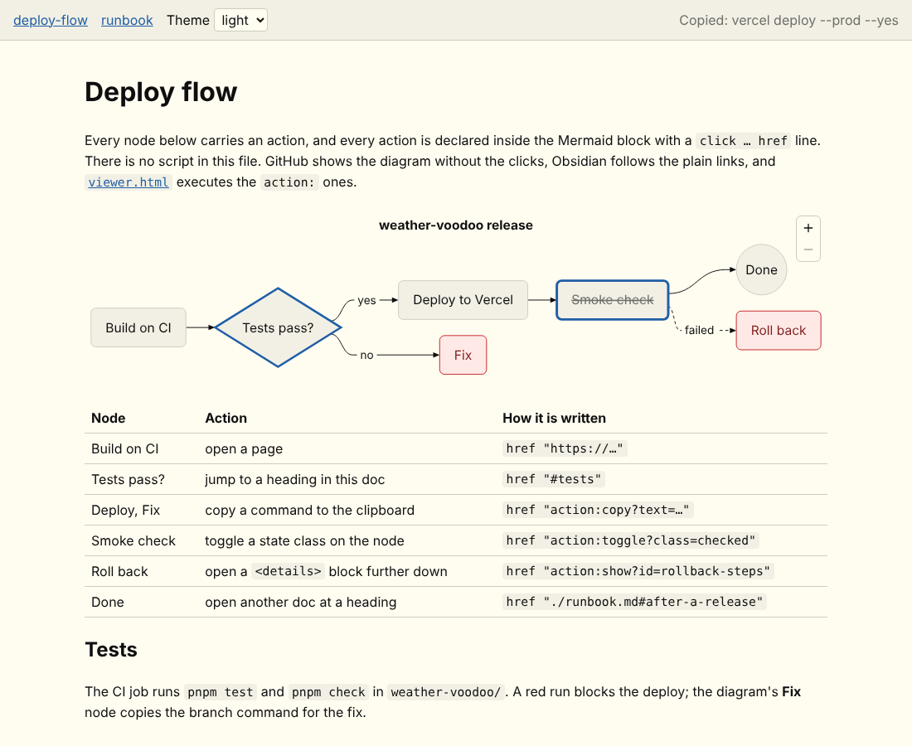
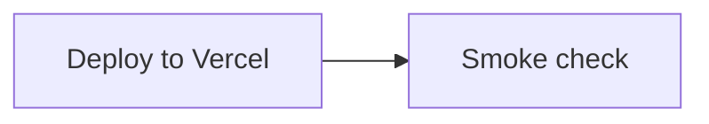

# mermaid-actions

Clickable actions for diagrams, declared inside plain Markdown + Mermaid files and executed by a
small viewer built on [Pele](https://pele.run/), Obsidian's Mermaid renderer. Nothing in the
docs is a script: every action is a `click … href` line in the Mermaid block, the look is a CSS
file, and the behaviour lives once in `mermaid-actions.js`.



## Run it

The viewer fetches the docs, so it needs any static server (not `file://`):

```bash
python3 -m http.server 8000 --directory mermaid-actions
# then open http://localhost:8000/viewer.html
```

`viewer.html?f=docs/runbook.md` opens another doc. The theme select switches light/dark; `auto`
follows the OS.

## How an action is written

A node gets an action by a `click` line with an `href`. The quoted text at the end is the tooltip.



| Action | `href` | Done by |
|---|---|---|
| open a URL | `"https://…"` | the browser; Pele emits a real `<a rel="noopener">` |
| jump to a heading in the same doc | `"#tests"` | the browser |
| open another doc at a heading | `"./runbook.md#after-a-release"` | viewer rewrites it to `?f=…#…` |
| copy text to the clipboard | `"action:copy?text=…"` (URL-encoded) | viewer |
| toggle a state class on the node | `"action:toggle?class=checked"` | viewer; `theme.css` styles `.checked` |
| open a `<details>` block in the prose | `"action:show?id=rollback-steps"` | viewer |
| link a kanban card to an issue | `@{ ticket: 54 }` + `ticketBaseUrl` in frontmatter | Mermaid |
| mark meaning or state | `class fix,rollback warn` + `classDef`, or `A@{ shape: … }` | Mermaid and CSS |

`action:` is the only non-standard part. It is a URL scheme, so it needs no new syntax and it
stays inside the diagram text. To add one, call `register(name, fn)` from `mermaid-actions.js`;
`fn(params, node, ctx)` receives the query parameters (`URLSearchParams`), the node's
`<g data-id>` element and `ctx = { root, doc, toast }`.

## The library and its hosts

`mermaid-actions.js` is a dependency-free ES module that owns the actions and the click handler:

```js
import { register, mount } from './mermaid-actions.js';
register('open-ticket', (p) => window.open(`https://example.com/t/${p.get('id')}`));
const { destroy } = mount(document, {
  toast: msg => console.log(msg),         // how a host shows messages
  onLink: (href, a, event) => {},         // other clicks with an href (nav, #heading, ./doc.md)
  // clicks: (target) => parseClicks(src), // for hosts whose renderer strips the link
});
```

`copy`, `toggle` and `show` are registered the same way, so a host can replace them. A host that
cannot get the link out of its renderer reads the `click` lines itself (`parseClicks(source)`) and
passes it to `mount` as `clicks`; the Obsidian and VS Code hosts do this. `watch` and `decorate`
mark the nodes that have an action (`ma-action`) as the diagram renders.

| Host | Folder | Install |
|---|---|---|
| Viewer | `viewer.html` | serve the folder, see above |
| Obsidian plugin | `obsidian/` | copy `main.js`, `manifest.json`, `styles.css` into `<vault>/.obsidian/plugins/mermaid-actions/`, enable it |
| VS Code Markdown preview | `vscode/` | `cd vscode && npx @vscode/vsce package`, then install the `.vsix`; needs the *Markdown Preview Mermaid Support* extension, which draws the diagrams |

`obsidian/main.js`, `obsidian/styles.css`, `vscode/extension.js`, `vscode/media/preview.js` and `vscode/media/preview.css` are generated from
`mermaid-actions.js` plus the `*.src.*` files next to them, so each ships as one file with no build on
the user's side. After editing a source, run `node build-hosts.mjs` (`--check` fails when a
generated file is stale). `node --test test/core.test.mjs` runs the unit tests.

The Obsidian and VS Code hosts were exercised with a stub of the host API and a real browser DOM,
not inside Obsidian or VS Code themselves. Obsidian: reading view only; Live Preview is untested.

## Where each part works

| | GitHub | Obsidian (Pele) | Obsidian + plugin | VS Code preview | VS Code + extension | This viewer |
|---|---|---|---|---|---|---|
| diagram | yes | yes | yes | with a Mermaid extension | yes | yes |
| `https://`, `#heading`, `./doc.md` links | stripped | yes | yes | depends on the Mermaid extension | depends on the Mermaid extension | yes |
| `action:` links | stripped | blocked scheme, so the node is simply not a link | executed (reading view) | not run | executed | executed |
| `classDef` colours | yes | yes, fixed colours in every theme | same | yes | yes | yes, fixed colours in every theme |
| classes styled from `theme.css` | no | no | `checked` only, from the plugin's `styles.css` | no | `checked` only, from `preview.css` | yes, follow light/dark |
| kanban ticket links | no | yes | yes | no | no | yes |
| `<details>` blocks in the prose | yes | yes | yes | yes | yes | yes |

So a doc degrades to a static diagram on GitHub, a diagram with links in Obsidian, and a diagram
with actions wherever a host from this folder is installed. The same file is committed in every case.

## Gotchas found while building this

Checked against Pele 1.10.0:

- Pele emits no `id` attributes on nodes. The Mermaid id is in `data-id` on the node's `<g>`;
  Mermaid class names and a `clickable` class are on the same element.
- Mermaid theme settings (`themeVariables`, `%%{init}%%`) are accepted and ignored. Colours come
  only from the `--pele-*` CSS variables in `theme.css`. `classDef` colours are honoured but become
  inline styles that do not follow the theme.
- `click node call fn()` callbacks are dropped silently.
- A `subgraph id@{ view: collapsed }` is a parse error in Pele and breaks the whole diagram.
- A `click` line must use single spaces; aligning the `href` column with extra spaces is a parse
  error.
- `marked` renders the raw HTML in the docs, so point the viewer only at docs you wrote.

## Files

```
mermaid-actions.js   the library: register / mount / parseClicks / nodeIdOf / decorate, built-in actions
viewer.html          Markdown → HTML (marked 16.1.2), each ```mermaid block → Pele 1.10.0, uses the library
obsidian/            Obsidian plugin (main.src.js → generated main.js, manifest.json, styles.css)
vscode/              VS Code Markdown preview extension (extension.src.js, media/preview.src.js, generated bundles)
build-hosts.mjs      builds the host bundles from mermaid-actions.js; --check for CI
test/core.test.mjs   unit tests for the library (node --test)
mermaid-actions.css  styles for the classes the built-in actions use; a host sets `--ma-accent`
theme.css            --pele-* variables for light/dark, styles for the semantic classes, page styles
docs/deploy-flow.md  every action type on one flowchart, plus a kanban with ticket links
docs/runbook.md      a second doc, to show jumps between docs
docs/viewer.png      screenshot of the viewer
```

Both libraries load pinned from jsdelivr; the viewer has no build step and nothing to install (only the Obsidian and VS Code bundles are generated, see above).
