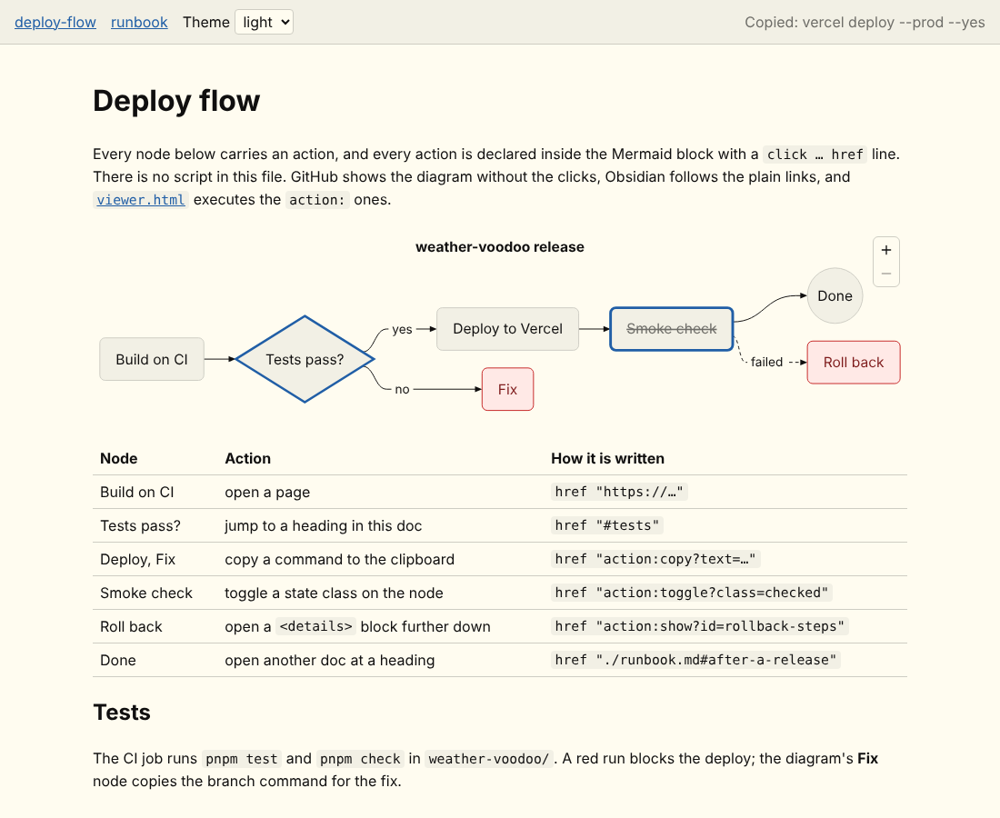
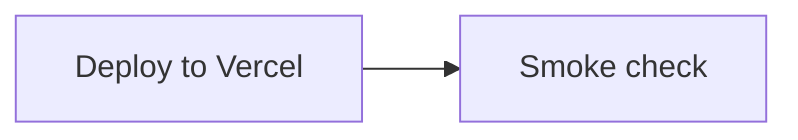

# mermaid-actions

Clickable actions for diagrams, declared inside plain Markdown + Mermaid files and executed by a
90-line viewer built on [Pele](https://pele.run/), Obsidian's Mermaid renderer. Nothing in the
docs is a script: every action is a `click … href` line in the Mermaid block, the look is a CSS
file, and the behaviour lives once in `viewer.html`.



## Run it

The viewer fetches the docs, so it needs any static server (not `file://`):

```bash
python3 -m http.server 8000 --directory mermaid-actions
# then open http://localhost:8000/viewer.html
```

`viewer.html?f=docs/runbook.md` opens another doc. The theme select switches light/dark; `auto`
follows the OS.

## How an action is written

A node gets an action by a `click` line with an `href`. The quoted text at the end is the tooltip.



| Action | `href` | Done by |
|---|---|---|
| open a URL | `"https://…"` | the browser; Pele emits a real `<a rel="noopener">` |
| jump to a heading in the same doc | `"#tests"` | the browser |
| open another doc at a heading | `"./runbook.md#after-a-release"` | viewer rewrites it to `?f=…#…` |
| copy text to the clipboard | `"action:copy?text=…"` (URL-encoded) | viewer |
| toggle a state class on the node | `"action:toggle?class=checked"` | viewer; `theme.css` styles `.checked` |
| open a `<details>` block in the prose | `"action:show?id=rollback-steps"` | viewer |
| link a kanban card to an issue | `@{ ticket: 54 }` + `ticketBaseUrl` in frontmatter | Mermaid |
| mark meaning or state | `class fix,rollback warn` + `classDef`, or `A@{ shape: … }` | Mermaid and CSS |

`action:` is the only non-standard part. It is a URL scheme, so it needs no new syntax and it
stays inside the diagram text. To add one, add an entry to the `actions` map in `viewer.html`;
it receives the query parameters and the node's `<g data-id>` element.

## Where each part works

| | GitHub | Obsidian (Pele) | This viewer |
|---|---|---|---|
| diagram | yes | yes | yes |
| `https://`, `#heading`, `./doc.md` links | stripped | yes | yes |
| `action:` links | stripped | blocked scheme, so the node is simply not a link | executed |
| `classDef` colours | yes | yes, fixed colours in every theme | yes, fixed colours in every theme |
| classes styled from `theme.css` | no | no | yes, follow light/dark |
| kanban ticket links | no | yes | yes |
| `<details>` blocks in the prose | yes | yes | yes |

So a doc degrades to a static diagram on GitHub, a diagram with links in Obsidian, and a diagram
with actions here. The same file is committed in every case.

## Gotchas found while building this

Checked against Pele 1.10.0:

- Pele emits no `id` attributes on nodes. The Mermaid id is in `data-id` on the node's `<g>`;
  Mermaid class names and a `clickable` class are on the same element.
- Mermaid theme settings (`themeVariables`, `%%{init}%%`) are accepted and ignored. Colours come
  only from the `--pele-*` CSS variables in `theme.css`. `classDef` colours are honoured but become
  inline styles that do not follow the theme.
- `click node call fn()` callbacks are dropped silently.
- A `subgraph id@{ view: collapsed }` is a parse error in Pele and breaks the whole diagram.
- A `click` line must use single spaces; aligning the `href` column with extra spaces is a parse
  error.
- `marked` renders the raw HTML in the docs, so point the viewer only at docs you wrote.

## Files

```
viewer.html          Markdown → HTML (marked 16.1.2), each ```mermaid block → Pele 1.10.0, one click handler
theme.css            --pele-* variables for light/dark, styles for the semantic classes, page styles
docs/deploy-flow.md  every action type on one flowchart, plus a kanban with ticket links
docs/runbook.md      a second doc, to show jumps between docs
docs/viewer.png      screenshot of the viewer
```

Both libraries load pinned from jsdelivr; there is no build step and nothing to install.
