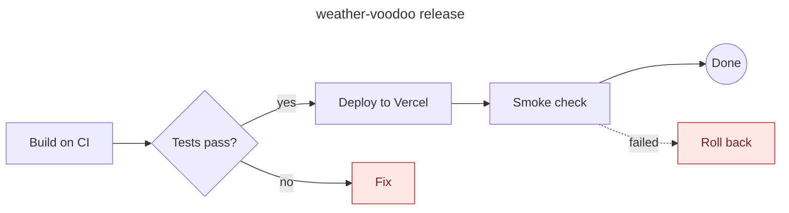
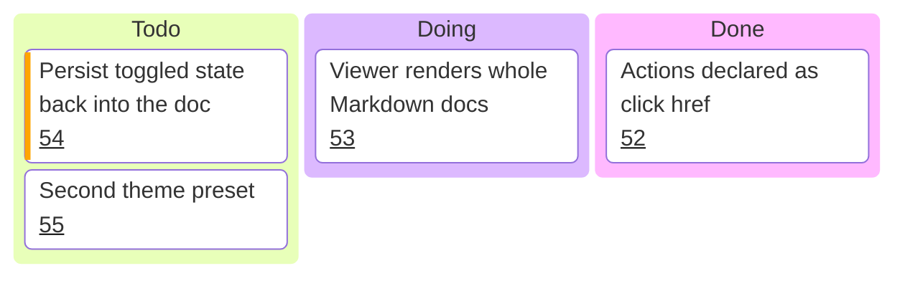

# Deploy flow

Every node below carries an action, and every action is declared inside the Mermaid block with a
`click … href` line. There is no script in this file. GitHub shows the diagram without the clicks,
Obsidian follows the plain links, and the viewer (`viewer.html` next to this folder) executes the `action:` ones.

| Node | Action | How it is written |
|---|---|---|
| Build on CI | open a page | `href "https://…"` |
| Tests pass? | jump to a heading in this doc | `href "#tests"` |
| Deploy, Fix | copy a command to the clipboard | `href "action:copy?text=…"` |
| Smoke check | toggle a state class on the node | `href "action:toggle?class=checked"` |
| Roll back | open a `
` block further down | `href "action:show?id=rollback-steps"` |
| Done | open another doc at a heading | `href "./runbook.md#after-a-release"` |

## Tests

The CI job runs `pnpm test` and `pnpm check` in `weather-voodoo/`. A red run blocks the deploy; the
diagram's **Fix** node copies the branch command for the fix.

## Rollback

Rollback steps

1. Open the Vercel dashboard for the project.
2. Pick the previous production deployment and promote it.
3. Note the failing commit in the release issue.

## Backlog

Kanban cards link to issues through `ticketBaseUrl` in the diagram's frontmatter. Mermaid fills in
the number, so the whole board stays plain text.

