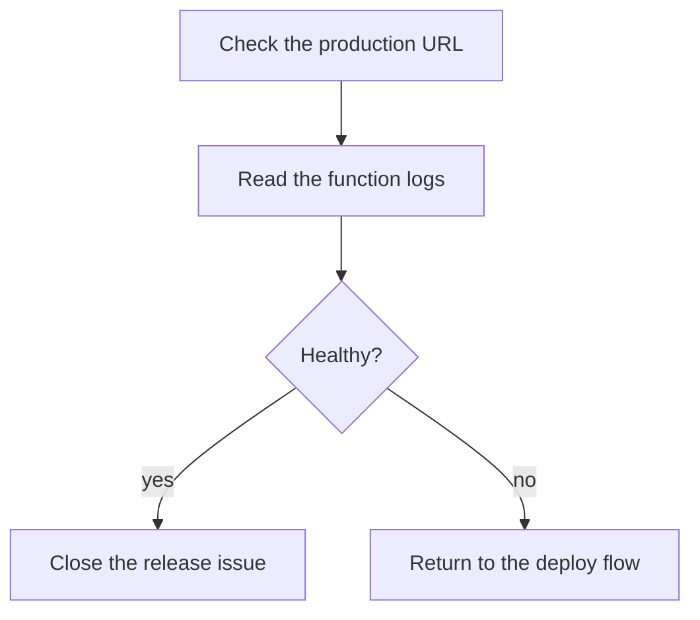

# Runbook

A second document, so the **Done** node in [`deploy-flow.md`](./deploy-flow.md) has somewhere to
jump to. Its own diagram links back.

## Before a release

Run the i18n check described in `weather-voodoo/CLAUDE.md` and confirm the preview deployment.

## After a release

Open the production URL, watch the logs for five minutes, then close the release issue.
