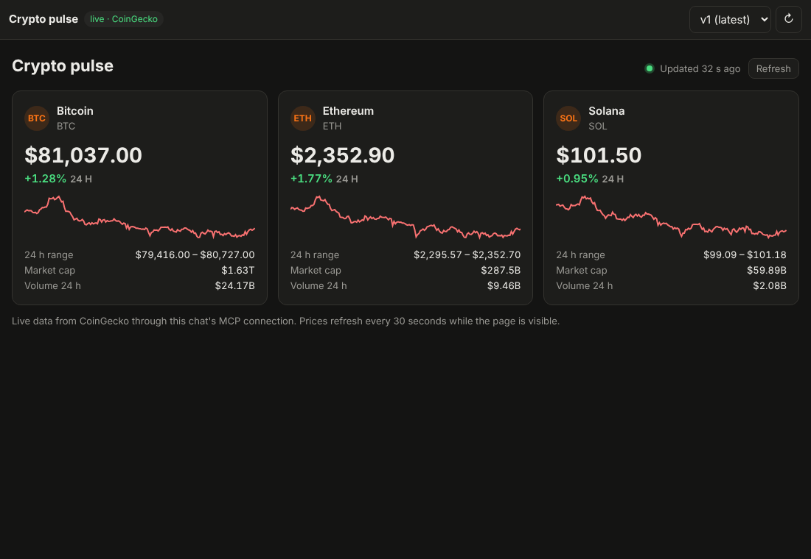
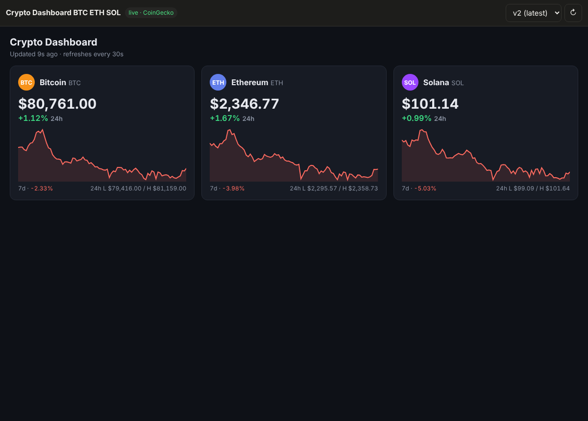

# pi-artifacts

A small reimplementation of Claude's artifacts on Cloudflare: chat with a [Pi](https://developers.cloudflare.com/agents/harnesses/pi/)
agent that builds **live dashboards**, preview them beside the chat, and share them by link. A published page pulls
**real-time data from MCP servers** each time someone views it, the way
[Claude's artifacts call MCP connectors](https://code.claude.com/docs/en/artifacts#pull-live-data-with-mcp-connectors).

- **Pi Durable** runs the agent inside a Durable Object, one per chat, and survives evictions mid-turn.
- **Durable Objects** hold each chat (agent, MCP connections, live calls) and each user's index of chats and artifacts.
- **Sandbox** (a Linux container per chat) runs the Python the agent writes, with no internet.
- **[Artifacts](https://developers.cloudflare.com/artifacts/)** keeps each published artifact as a Git repo: one commit
  and tag per version.
- **R2** keeps each user's files, which the agent reads and writes, plus a read cache of artifact versions.
- **The demo MCP server is [CoinGecko's public one](https://mcp.api.coingecko.com/mcp)**: free, keyless, live crypto market data.



## How live data works

The page never talks to the network. Its CSP is `connect-src 'none'`. It calls `pi.use("mcp")`, and every call travels
to **the same MCP connection the agent used to build it**:

```
artifact page (sandboxed iframe, opaque origin)
  │  mcp.watchTool("CoinGecko", "execute", {code}, onEvent, {refetchInterval: 30_000})
  ▼  MessagePort, handed over once, in answer to the page's hello
viewer page: ArtifactBroker (src/artifact/broker.ts)
  │  caches, groups identical watches, pauses while the tab is hidden, polls on the server's hint
  ▼  POST /api/artifacts/:id/mcp  {version, mode, server, tool, input, staleMs}
Worker: finds the artifact's chat
  ▼  RPC
ChatAgent Durable Object (worker/chat-agent.ts)
  ├─ is (server, tool) in this version's manifest?      no → not_in_manifest
  ├─ read-only tool? cache + one shared request in flight (McpHub.read)
  ├─ a write? only the page's author may call it          no → not_granted
  └─ McpHub ─► MCP server (no model involved: deterministic, quick, no tokens)
```

**The manifest.** When the agent publishes, it declares the servers and tools the page may call
(`[{server: "CoinGecko", tools: ["execute"]}]`). Publishing checks those names against the server's real tool list and
refuses a mismatch. Each version keeps its own manifest; a page cannot widen it.

**Whose connection.** Calls use the chat's MCP connections, so they run as the page's author. Claude's artifacts use
each viewer's own connectors instead. Two things follow from that:

- Sharing a page shares the data its manifest allows.
- Tools that are not marked `readOnlyHint` are refused for everyone but the author, are never cached and cannot be
  watched.

CoinGecko needs no sign-in. Juyo needs each user's own; see [Servers that need your own sign-in](#servers-that-need-your-own-sign-in).

**Polling with a server hint.** Every response carries `nextRefreshAt`: when the Durable Object's copy goes stale.

- The viewer asks again 0.25–1.25 s after that time, so it shows a new upstream result within about a second of the
  Durable Object fetching it. That is as fresh as WebSocket push would be, without the sockets.
- `refetchInterval` has a 30 s floor, as at Claude.
- Each server's results are cached per viewer by default (`cacheScope: "viewer"` in `worker/mcp/servers.ts`, the way
  Claude keeps viewers apart). Switch a keyless server to `"shared"` to let every viewer reuse one upstream call per
  interval.

Measured against CoinGecko:

- One `execute` call takes 0.6–0.9 s.
- The prices it returns are already 18–32 s old.

So upstream freshness, not the transport, sets how live the page can be.

## Servers that need your own sign-in

Juyo (hotel data) is reached through the Cloudflare MCP portal `juyo`, which fronts the MCP server `juyo2`. Juyo
signs people in with Cognito, and every user must use their own account, so the app is an ordinary MCP OAuth client
of the portal (`worker/mcp/oauth.ts`, built on the MCP SDK):

1. **Connections** in the sidebar lists the servers. Juyo shows **Sign in** until you have.
2. Sign in opens a popup. The Worker discovers the portal's authorization server, registers a client (dynamic
   registration) and builds a PKCE authorization URL whose `state` names the server.
3. In the popup you sign in to Cloudflare Access for the portal, then select **Connect** for `juyo2` and sign in to
   Cognito. The portal keeps your Cognito session; the app never sees it.
4. The portal sends the popup back to `/api/mcp/oauth/callback`. The Worker checks the `state` against the sign-in it
   started for *you* (the callback needs your app session too), exchanges the code, and stores your tokens. The popup
   tells the app and closes.

Where things live and who can use them:

- **Tokens are per user.** They are kept in your `UserDirectory` Durable Object, which only requests carrying your
  verified identity reach. All your chats share them, and nobody else's chats can.
- **Chats call as you.** A chat's connection to Juyo carries your token, which the SDK refreshes when it expires. When
  it can't be refreshed, or you signed out, calls fail with `auth_required`. The agent's prompt names Juyo as
  unavailable and why, so it can tell you to sign in. After you do, your next prompt picks up Juyo's tools.
- **Pages with Juyo data are for their author only.** A page calls through its author's chat, so it would show the
  author's data to anyone who opens the link. Juyo is therefore marked `pageCallers: "author"`. The author's own
  views load; anyone else gets `not_granted`. Claude's artifacts instead use each viewer's own connectors; doing that
  here means routing a viewer's calls through their own tokens.
- **The portal's own tools are hidden.** `portal_list_servers` and the like switch servers on and off for a session,
  so neither the agent nor pages see them (`hideTools`).
- **Sign out** forgets your tokens here. To end the portal's session as well, sign out on the portal's home page.

`test/mcp-oauth.test.ts` runs the whole flow against a stand-in portal with discovery, registration, PKCE and refresh:
- a sign-in;
- two users kept apart;
- a forged `state` refused;
- refresh on expiry;
- `auth_required` when refresh fails, leaving an open sign-in untouched.

Locally, `JUYO_PORTAL_URL=… pnpm dev` points Juyo at another portal.

Setting up the portal (Zero Trust → Access controls → MCP Portals):

- The portal needs its own hostname, a subdomain of a zone in the account. On the bare domain of a site that already
  exists, `/mcp` reaches the site instead.
- Both the portal's Access application and `juyo2`'s need an Allow policy listing who may use them. Without one,
  nobody can sign in.
- Keep **Require user auth** on for `juyo2`: that is what makes each person sign in to Cognito themselves.
- Set the portal's `/mcp` address as `JUYO_PORTAL_URL` in `cloudflare.config.ts`.

## The page runtime

`runtime/pi-runtime.js` is inlined at the top of every published page. It mirrors the shape of Claude's
`window.claude.use("mcp")`, so a model that knows one writes the other. `runtime/runtime.d.ts` is the contract, and the
agent reads it in its system prompt.

```js
const mcp = await pi.use("mcp");                    // null outside a viewer: render a static fallback
const stop = mcp.watchTool("CoinGecko", "execute", { code }, (ev) => {
  if (ev.type === "data") render(ev.result.payload, ev.result.cache?.storedAt);
  else showSectionError(ev.error.code);             // server_unavailable, not_in_manifest, tool_error, …
}, { refetchInterval: 30_000 });

const docs = await mcp.CoinGecko.search_docs({ query: "markets" });   // one-shot call, resolves to the payload
await mcp.invalidate("CoinGecko");                                    // refetch now
```

[`examples/crypto-dashboard.html`](examples/crypto-dashboard.html) is a complete page written against it.

## Layout

| Path | What |
|---|---|
| `worker/index.ts` | Routes: identity, chats, chat WebSocket, artifact pages (`/u/:id/v:n`), the MCP proxy, files |
| `worker/chat-agent.ts` | `ChatAgent` DO: `PiHarness`, the chat socket, `artifactCall`, rate limit |
| `worker/mcp/`, `worker/mcp-routes.ts` | `McpHub` (connections, cache, coalescing, hint), the MCP SDK connector, the server list, per-user OAuth sign-in and its routes |
| `worker/agent/` | Pi tools (MCP, files, artifacts, `run_python`) and the system prompt |
| `worker/artifacts/` | Manifest checks, the CSP and the runtime injection |
| `worker/auth/`, `worker/storage/` | Access token verification; the storage gatekeeper: artifact repos, per-user encrypted files |
| `cloudflare.config.ts` | The Worker, its bindings, Durable Object exports and the sandbox container (cf CLI) |
| `worker/users.ts`, `worker/sandbox.ts` | `UserDirectory` DO (chats and artifacts per user), `Sandbox` DO (the container) |
| `runtime/` | The page runtime and its contract |
| `src/` | React app: chats, the streamed transcript, the preview panel, `ArtifactBroker`, Connections; resizable columns (`layout.tsx`) |
| `shared/` | Types and helpers used by all of the above |

## Run it

```sh
pnpm install
pnpm dev        # cf dev: needs a Cloudflare login (cf auth login; the AI binding is remote) and Docker (the sandbox)
```

- **Locally, sign in with a typed name:** `AUTH_MODE=demo pnpm dev`. Without it the app expects Cloudflare Access,
  which only exists once deployed.
- **Without a Cloudflare account or Docker:** run `AUTH_MODE=demo PI_OFFLINE=1 PI_NO_DOCKER=1 pnpm dev`. Everything
  works except the model and `run_python`.
- **Testing live data without the model:** start with `DEV_TOOLS=true` added to the command above, which enables a
  publish route, then publish the example page into a chat:

  ```sh
  curl -c jar -X POST localhost:5173/api/session -H 'content-type: application/json' -d '{"name":"ada"}'
  CHAT=$(curl -s -b jar -X POST localhost:5173/api/chats | jq -r .id)
  jq -n --rawfile html examples/crypto-dashboard.html '{title:"Crypto pulse", html:$html, mcp:[{server:"CoinGecko",tools:["execute"]}]}' \
    | curl -s -b jar -X POST localhost:5173/api/dev/chats/$CHAT/publish -H 'content-type: application/json' -d @-
  # → {"artifactId":"…","version":1}; open http://localhost:5173/a/<artifactId>
  ```

Tests: `pnpm test` covers the hub, the broker, Access token checks and the storage rules (including a test that fails
if code outside `worker/storage/` touches the bucket). `LIVE=1 pnpm test` also calls CoinGecko. Typecheck with
`pnpm typecheck`.

## Deploy

The project uses Cloudflare's [`cf` CLI](https://developers.cloudflare.com/cf/); its configuration is
`cloudflare.config.ts`, migrated from Wrangler with `cf migrate`.

1. `cf auth login`. Add `--no-browser` on a remote machine: it prints a link and a code to approve.
2. Enable R2 for the account in the dashboard, then create the bucket: `cf r2 buckets create --name pi-artifacts`.
   The Artifacts namespace `pi-artifacts` needs no setup: it is created with the first repo. Artifacts needs the
   Workers Paid plan.
3. Create an AI Gateway named `pi-artifacts` and store an Anthropic key in it (BYOK), or use unified billing.
   `MODEL` in `cloudflare.config.ts` is a pi-ai gateway specifier (`anthropic/claude-sonnet-5.5`). A Workers AI id
   such as `@cf/zai-org/glm-5.3-flash` needs no key.
4. Put the app behind Cloudflare Access: create a self-hosted Access application for the Worker's hostname with a
   policy listing who may sign in, then set `ACCESS_TEAM_DOMAIN` and `ACCESS_AUD` (the application's audience tag) in
   `cloudflare.config.ts`.
5. Generate the file-encryption master key (`openssl rand -base64 32`, at least 32 bytes) and keep a copy somewhere
   safe: losing it makes every user's files unreadable, and changing it later needs a migration (see
   [How file encryption works](#how-file-encryption-works)). Pass it as a secret:
   `cf deploy --secrets-file secrets.json` with `{"FILES_MASTER_KEY": "…"}`, then delete `secrets.json`. Later deploys
   keep the secret, so they need no `--secrets-file` unless it changes.
6. `pnpm run deploy` (`cf deploy`). This builds the sandbox image with Docker and needs the Workers Paid plan.

## Who can read what

- **Sign-in:** Cloudflare Access lets only the people in its policy reach the app at all. The Worker then verifies the
  token Access signs (signature against the team's keys, issuer, audience, expiry) and derives the user's id from it.
  The id never comes from the browser or the model.
- **One gatekeeper for storage:** only `worker/storage/` touches the R2 bucket or the Artifacts binding, and a test
  enforces it. Everything else gets either the artifact store or a `UserFiles` handle scoped to one user, which builds
  every key under that user's folder and rejects paths like `..` or absolute paths.
- **Per-user encryption:** user files are stored with R2 customer-supplied keys (SSE-C), one key per user. See
  [How file encryption works](#how-file-encryption-works).
- **Artifacts** are shared by link with anyone Access lets in, and are not encrypted per user. Only their owner's chat
  can publish new versions, and only their owner can clone their repo. See
  [Versions in Git](#versions-in-git).

### Versions in Git

Each published artifact is a repo, `artifact-<id>`, in the Cloudflare Artifacts namespace `pi-artifacts`
(`worker/storage/artifacts.ts`).

- **Each publish is one commit, tagged `v<n>`.** The commit holds `index.html` and `artifact.json`: the metadata and
  every version's manifest. The agent passes a one-line `message`, which becomes the commit message (`v3: Add a 7-day
  sparkline`).
- **The repo is the source of truth; R2 is a read cache.** A publish writes each new version and the latest metadata
  to R2 too, so page views and live calls never touch Git. If the cache is missing something, it is read back from
  the repo and the cache is filled again.
- **Pushing from a Worker.** The Artifacts binding manages repos and reads files, but it cannot write them. A publish
  therefore uses [isomorphic-git](https://isomorphic-git.org/) on an in-memory filesystem: a depth-1 clone, one
  commit, then a push of `main` and of the tag.
- **The agent can see its history.** `artifact_history` lists the versions with their messages, and `artifact_diff`
  shows a unified diff of the page between two of them.
- **Older artifacts.** An artifact published before repos existed has only its R2 copy. It keeps serving from there,
  and the first new publish replays its versions into a new repo, one commit each with their original dates.

How users stay apart:

- **The binding is not per user.** `env.REPOS` can open every repo in the namespace, and Artifacts knows nothing about
  our users. Only `worker/storage/` may use it, and repo names come only from artifact ids whose owner the Worker
  has checked against the verified Access identity.
- **Git tokens are scoped to one repo, and short-lived.** Each publish mints a 5-minute write token for that one repo
  and revokes it after the push, along with the day-long token `create()` returns.
- **Owners can clone.** The preview's `git` button calls `POST /api/artifacts/:id/clone`, which only the owner may
  call. It returns a read-only token for that one repo, valid for 15 minutes, as a ready `git clone` command. Pushing
  with it is refused.
- **No per-user encryption here.** Artifacts are already shared by link, so nothing is lost. Private user files stay in
  R2 under per-user keys; see below.

Locally, `cloudflare.config.ts` points `REPOS` at a local Git backend (`dev: {remote: false}`, which needs `git`
installed), so development never touches the deployed repos. `test/artifact-store.test.ts` runs the store's real Git
code against `git http-backend`.

### How file encryption works

The master key never encrypts anything itself. It only derives each user's key, and R2 encrypts with that key.

```
Access token (verified) → sub
uid     = first 32 hex chars of SHA-256("<team domain>:" + sub)                  worker/auth/index.ts
userKey = HKDF-SHA-256(ikm = FILES_MASTER_KEY,                                   worker/storage/keys.ts
                       salt = "pi-artifacts/user-files/v1", info = uid) → 256 bits
UserFiles(uid, userKey): keys under users/<uid>/files/, every put/get passes {ssecKey: userKey}
                                                                                  worker/storage/user-files.ts
```

- **No key is stored.** The derivation is deterministic, so a user's key is recomputed whenever their files are
  opened.
- **R2 encrypts with AES-256 and keeps only a fingerprint of the key.** A read without the key, or with another user's
  key, is refused.
- **A leaked user key reveals neither the master key nor anyone else's key.** HKDF is one-way.
- **Two independent locks.** The path prefix is one and the key is the other. A prefix bug, or someone with only an R2
  API token or the dashboard, can see objects but not read them.

What it does not cover:

- **It is not end-to-end encryption.** The Worker holds the master key, so it can derive any user's key, and it must, so
  the agent can read your files for you. Anyone who can deploy this Worker or read its secrets can read every file.
- **Metadata is visible.** Only file contents are encrypted. Object names (file paths), sizes, upload times and content
  types are not.
- **Losing the master key loses every file.** Changing it is a migration: read each file with the old key and write it
  back with the new one. The `v1` in the salt leaves room for a second scheme during such a migration.
- **The local R2 simulator ignores SSE-C.** In `AUTH_MODE=demo` a fixed demo key stands in for the master key, and
  files are stored unencrypted. A deployed Worker without `FILES_MASTER_KEY` refuses all file access.

Artifact pages are served from the app's own origin inside an opaque-origin sandbox. That is enough to keep them away
from the app's cookies and storage. A production deployment should still serve `/u/*` from a separate domain, as
claude.ai uses `*.claudeusercontent.com`.

## Limits and what's next

- **Access policy is per email.** Adding people means adding them to the Access policy. Per-viewer consent for live
  data (as in Claude's artifacts) is not built yet.
- **Verified deployed with Claude Sonnet 5.5:** the agent built a live BTC/ETH/SOL dashboard from one prompt and, when
  told what was wrong, fixed it as version 2 of the same artifact.

  

  Also verified deployed:
  - `run_python` wrote a file into the user's files;
  - R2 refuses to read that file without its key ("stored using a form of Server Side Encryption");
  - a publish created the artifact's repo, and its `git` button produced a working clone command.

  The Juyo sign-in has been verified only locally, against a stand-in portal, because the `juyo` portal is not
  reachable yet (see [Servers that need your own sign-in](#servers-that-need-your-own-sign-in)).
- **Pi Durable is experimental.** It has no tool approvals, conversations can't be deleted yet, and a reconnecting
  client resumes from a fresh snapshot rather than a cursor.
- **Next:**
  - a screenshot self-check in the sandbox before publishing
  - live data from servers like Juyo for every viewer, each with their own sign-in
  - WebSocket push for sources that stream
  - a separate preview domain
