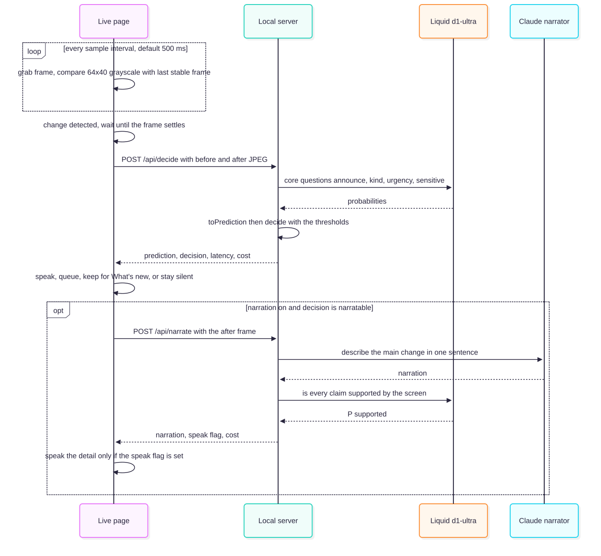

# screen-narrator-d1

A playground for testing whether Liquid AI's **d1-ultra** decision model can be the "brain" of a screen
narrator for blind and low-vision users: it looks at what changed on screen and decides **whether to speak,
what kind of thing happened, and how urgently** — and we measure how well it does that against simple
baselines.

> **Status: working prototype.** Capture, benchmark, report and live mode all run. The Claude VLM baseline and
> narrator have been checked only against mocked clients so far: no Anthropic credentials were set up. See
> [What's done](#whats-done-and-whats-next).

## Quick start

```bash
pnpm install
cp .env.example .env            # then set LIQUID_API_KEY (and optionally ANTHROPIC_API_KEY)
pnpm capture --clean            # 142 synthetic before/after pairs → data/pairs/ (~17 s, Playwright)
pnpm bench --dry-run            # what it would ask, and the estimated cost
pnpm bench                      # d1-ultra, d1, pixel-diff on every pair → runs/<id>/results.json
pnpm report                     # → runs/<id>/report.html (prints an xdg-open line)
pnpm live                       # http://127.0.0.1:5178: share a screen or tab, hear what it would announce
pnpm test && pnpm typecheck
```

`pnpm bench` flags: `--backends d1-ultra,d1,pixel-diff,vlm`, `--questions core|all`, `--filter TEXT`,
`--limit N`, `--concurrency N`, `--no-cache`, `--dry-run`. Paid answers are cached in `runs/cache/`, keyed by
backend settings, question wording and image bytes, so re-runs are free until something changes.
`pnpm report --sample` renders the layout from synthetic answers. `pnpm tsx src/smoke.ts` makes one tiny real
call to each Liquid model.

## How it works



There are two ways to use it: an offline **benchmark** that scores the models on known answers, and a **live
mode** that shows what a narrator built on d1-ultra would actually say. The Mermaid sources for every diagram
are in [`docs/`](docs/diagrams.md).

**1. Capture** (`pnpm capture`). Playwright screenshots six small fake web apps before and after 17 scripted
changes (a dialog opens, a toast slides in, a card is hovered…). The script made the change, so the right answer
is known: **142 labelled pairs** in `data/pairs/`. See [Dataset](#dataset-synthetic-screens-labels-known-by-construction).

**2. Benchmark** (`pnpm bench`). Every backend (d1-ultra, d1, pixel diff, a Claude VLM) gets the same pair and
the same questions, and the answers go to `runs/<id>/results.json`. See
[the question set](#what-we-test-the-question-set) and [Baselines](#baselines-what-helps-is-measured-against).

**3. Report** (`pnpm report`). One self-contained HTML page per run with the [Metrics](#metrics), and a browser
of every pair: its label, each backend's probability bars, and filters for "wrong" and "confidently wrong".

What the benchmark is designed to expose:

```text
pair: shop hover card (30–46 % of pixels change, purely cosmetic)
  pixel diff → announce   ✗
  d1-ultra   → stay quiet ✓

pair: "Settings saved" toast (1–4 % of pixels)
  pixel diff → stay quiet ✗ (on most variants)
  d1-ultra   → announce, queue ✓
```

### From probabilities to speaking

d1-ultra only returns probabilities. `src/policy.ts` turns them into what a narrator does, and both the
benchmark's noise metric and live mode use it:



Text version of the diagram:

- Below `thresholds.announce` on P(announce): **drop**, stay silent.
- Otherwise the rounded urgency level picks the action: 0 **drop**, 1 **mention** (keep it for when the user
  asks "What's new?"), 2 **queue** (say it after the current speech), 3 **interrupt** (say it now). A backend
  with no urgency answer (pixel diff) queues.
- The phrase comes from the kind ("Dialog opened"). Below `thresholds.confident` it is hedged ("Probably:
  dialog opened"); with no kind answer (pixel diff) it is "Screen changed".
- At or above `thresholds.sensitive` on P(sensitive), it appends "Sensitive content, not read aloud" and adds
  no generated detail. Otherwise a queued or interrupting announcement may get a Claude detail sentence,
  spoken only if it passes the fact-check.

### Live mode



Text version of the diagram:

- The page watches a shared tab or screen and does a cheap local comparison every 500 ms. It only asks
  d1-ultra when something actually moved and the screen has settled, which keeps the cost low.
- The local server holds the API keys, asks Liquid the four core questions, applies the policy and returns the
  decision. The page speaks it with the browser's text-to-speech and logs why it spoke or stayed quiet.
- With narration on, Claude writes one detailed sentence ("Dialog: Delete 3 messages? Buttons Cancel and
  Delete") and d1-ultra fact-checks it against the screen. The detail is spoken only if it passes; a
  rejected one is shown struck through in the log.

**Live mode sends your screen to Liquid's cloud.** Only point it at windows with nothing private on them.

## First results (run 20261019-142237)

142 pairs (102 transition pairs and a 40-frame session), all six questions, synthetic fixtures. 130 pairs have a
clear `announce` label; 12 are ambiguous and left out of the scores.

| | d1-ultra | d1 | pixel diff |
|---|---|---|---|
| `announce` accuracy | **100 %** | 91.5 % | 83.1 % |
| `announce` Brier / ECE | **0.012** / **0.073** | 0.069 / 0.106 | 0.156 / 0.169 |
| AUROC | **1.00** | 0.99 | 0.86 |
| Session: announcements/min (labelled: 3.0) | **3.0** (0 false, 0 missed) | 7.0 (9 false, 1 missed) | 4.0 (2 false) |
| `kind` top-1 | **82.9 %** | 78.3 % | — |
| `urgency` false / missed interrupts | 4.8 % / 19 % | 4.8 % / **7.7 %** | — |
| `sensitive` accuracy | 95.8 % | 95.8 % | — |
| `primary` / `supported` | 100 % / 100 % | 100 % / 100 % | — |
| p50 latency (4 calls at a time) | 3.5 s | 2.9 s | 86 ms |
| Cost for the whole run | $0.017 | price not published here | free |

How to read this:

- **The gate works on these fixtures.** d1-ultra separated "worth announcing" from "not" perfectly. It wasn't
  fooled by large cosmetic changes (the hover card) or by small important ones (the toast), and it matched the
  labelled rate exactly on the session. Pixel diff is about as good on the session only because most idle
  frames there are byte-identical.
- **d1-ultra's mistakes are defensible.** Every `kind` miss calls a near-invisible change (a spinner frame or a
  clock tick, about 0.01 % of pixels) `none` instead of `cosmetic`. Its only `sensitive` misses are a partly masked
  card number (`•••• 4242`), a label people could argue about. d1 instead missed the private chat messages.
- **Benchmark latency is not live latency.** The table's 3.5 s p50 (16 s p95) is 4 concurrent requests with
  full-size PNGs. Live mode sends one downscaled JPEG pair at a time, and a single call there took ~0.6 s.
  For an "interrupt now" gate the live number is the one that matters, so measure it when you try screen
  sharing.
- **Urgency is the weakest part.** d1-ultra under-calls some interrupts (19 % missed). The rubric wording is the
  first thing to tune.
- **Caveat: these are synthetic, clean screens labelled by their author.** Treat 100 % as "the task is
  learnable", not as a production number. Real, messy apps are the next test.
- **Billing differs from the docs.** `usage.input_tokens` counted the images once per request (about 2.9k tokens
  per pair), not once per question, so a full run cost under 2 cents.

## Why d1-ultra is the gate, not the narrator

d1-ultra ([launch post](https://www.liquid.ai/blog/d1-ultra), released 2026-10-15) is a *decision* model.
It takes `state` (text/JSON) plus up to 8 images and a set of questions, and returns **calibrated
probabilities** in one forward pass. It generates no text. Three question types:

| Type | Asks | Returns |
|---|---|---|
| `noul` | yes / no | `{ noul: 0…1 }` |
| `choice` | one label out of named options (`criteria`: label → description) | `{ choice, confidence, probabilities }` |
| `score` | a position on an ordered rubric (`criteria`: array of levels) | `{ score, confidence, probabilities, legend }` |

So it cannot *describe* a screen. What it can do is the part screen narrators usually get wrong: **when to
talk and when to stay quiet.** Talking over the user for every hover highlight is as bad as missing an error
dialog. A calibrated "should I announce this?" probability lets us set thresholds for interrupt / queue /
drop, and hedge ("probably a close button") instead of stating guesses as facts.

It can read what's on screen (it has to, to tell an error from a toast), but it can't *output* that text or
any element positions. It's also cloud-only (no weights for d1-ultra; d1-3B and d1-omni-600M
are open-weight). The design works around both.

## What we test: the question set

Every test case is a **pair of screenshots**: `images[0]` = before, `images[1]` = after (the docs say image
order matters and to refer to images by position). `state` frames the situation:

```json
{
  "images": "images[0] is the screen before, images[1] is the same screen about one second later",
  "user": "The user is blind and uses a screen reader; they only know what is announced to them",
  "focused": "optional: the control that has keyboard focus, from the accessibility tree"
}
```

The questions (wording is a first draft; the benchmark exists to tune it):

| Key | Type | Question | Why |
|---|---|---|---|
| `announce` | noul | Did something change that a blind user needs to be told about to keep using the app — a dialog, an error, a message, new content, a change to the control they are on? (false = nothing, or only cosmetic: hover, animation, spinner frame, clock tick) | **The core gate** |
| `kind` | choice | What is the main change? `dialog` · `error` · `notification` · `navigation` · `content` · `scroll` · `cosmetic` · `none` | Picks the announcement template ("Dialog opened", "Error") |
| `urgency` | score | How urgently? 0 drop it · 1 mention when asked "what's new" · 2 after current speech · 3 interrupt now | Interrupt / queue / drop policy |
| `sensitive` | noul | Does `images[1]` show a password, card or bank details, private messages, health or ID documents? | Redact before any narration |
| `primary` | choice | Which of these elements is the main action? — `criteria` built from the accessibility tree (`e0: "button 'Save'"`, …) | Works around no bounding boxes |
| `supported` | noul | Is every claim in `narration` visibly supported by `images[1]`? | Fact-checks a generative narrator |

The last two need extra inputs (accessibility candidates, a narration), so they come after the four core ones.

`sensitive` on hosted d1-ultra is only a capability test: asking the question already sends the screen
to the cloud. It only protects anything when it runs on-device (d1-3B).

## Dataset: synthetic screens, labels known by construction

No real screenshots: they leak private data, and hand-labelling them is slow and arguable. Instead:

- **6 small HTML fixture apps** (`fixtures/`: mail, settings, chat, shop, bank, news) with **17 scripted
  transitions** (`fixtures/scenarios.ts`), each labelled by the script that produces it. The core ones:

  | Transition | announce | kind | urgency |
  |---|---|---|---|
  | confirm dialog opens | yes | dialog | 3 |
  | session-expiry warning | yes | dialog | 3 |
  | form validation error | yes | error | 3 |
  | "Saved" toast | yes | notification | 2 |
  | new chat message | yes | notification | 2 |
  | page navigation | yes | navigation | 2 |
  | cookie banner | yes | dialog | 2 |
  | infinite scroll appends items | yes | content | 1 |
  | user scrolled | no | scroll | 0 |
  | hover highlight / focus ring | no | cosmetic | 0 |
  | spinner frame, clock tick, rotating ad | no | cosmetic | 0 |
  | nothing changed | no | none | 0 |

- **Playwright** opens each fixture, captures "before", runs the transition, captures "after".
  Variants multiply the set: light/dark theme × 3 viewports (1280×800, 1024×768, 390×844), with text
  density and language (en/es) rotated across them, so 17 transitions × 6 = 102 pairs. A scripted
  40-step "2 minutes in the mail app" session adds 40 more for the noise metric. Small important changes (a
  toast in a corner) and large cosmetic ones (hovering a big card) are both in there on purpose: they're what
  fools pixel diffs. The variant goes in the fixture URL's fragment (`mail.html#theme=dark&lang=es`), and
  each app exposes `window.fixture.trigger(name)` for timed events.
- Debatable cases (a rotating ad, a dark-mode toggle) are labelled `ambiguous`: shown in the report, left
  out of accuracy.
- Capture writes `data/pairs/<id>/{before,after}.png` and `data/pairs/index.json` (`Pair[]`, see
  `src/types.ts`). Your own screenshots can go in `data/private/` (gitignored) with a hand-written index in
  the same shape, passed with `pnpm bench --index`.

Screenshots are at most 1280×800 (1,000 patches, 1,500 Liquid tokens each).

## Baselines: what "helps" is measured against

1. **Pixel diff:** "announce if more than N % of pixels changed". Free and instant. Expected to fail on
   hover highlights (big change, means nothing) and toasts (small change, matters).
2. **d1:** the smaller Liquid decision model. Same request with a different `model` field.
3. **d1-ultra:** the model under test.
4. **A generative VLM** (e.g. a Claude model, set by env var, never hardcoded) asked the same questions
   with JSON output. This tests the claim behind decision models: are probabilities you parse from a chat
   model as reliable, as cheap and as fast?
5. *Later:* **d1-3B self-hosted.** It's the only option that keeps screen pixels on the device.

## Metrics

Per backend, per question:

- **Accuracy** at the chosen threshold, plus a **confusion matrix** for `kind`.
- **Calibration:** Brier score, ECE and a **reliability diagram** (predicted probability vs. how often it
  was right). Calibration is d1-ultra's main claim, so the diagram is the main chart.
- **Urgency:** mean absolute error against the labelled level, and how often it would interrupt when it
  shouldn't (the worst mistake for a screen reader user).
- **Noise:** replay a scripted 2-minute session of frames and count announcements per minute per backend.
- **Cost and latency:** tokens and dollars per pair from `usage.input_tokens`, plus p50/p95 latency.

## Costs

Liquid charges d1-ultra at $0.042 per million input tokens and nothing for output. The docs say images are
billed again for every question, but measured `usage.input_tokens` counts them **once per request**:

- one 1280×800 pair ≈ 2 × 1,500 image tokens + ~110 per question ≈ **3.5k tokens ≈ $0.00015**
- full benchmark (142 pairs, all questions): **$0.017** for d1-ultra (measured)
- live mode worst case (a pair every second, no diff gate) ≈ **$0.50 per hour**; with the gate, a small
  fraction of that
- d1's price isn't hardcoded: set `LIQUID_D1_USD_PER_MTOK` to see its cost column
- the Claude VLM baseline is the expensive one (≈ 2–3k image tokens per pair at Claude rates, plus thinking).
  Check `pnpm bench --dry-run --backends vlm` first, then try `--limit 1`.

## Layout

```
screen-narrator-d1/
  .env.example         LIQUID_API_KEY, ANTHROPIC_API_KEY, NARRATOR_VLM_MODEL / _EFFORT, PIXEL_DIFF_THRESHOLD, …
  docs/                Mermaid diagrams (*.mmd) → *.svg via `pnpm diagrams` (mermaid.json: Arial, no embedded font),
                       shown in docs/diagrams.md
  fixtures/            6 HTML apps (+ common.js/css) and scenarios.ts: transitions, variants, labels, the session
  src/
    types.ts           the shared contracts: Pair, Prediction, PairResult, RunResult
    questions.ts       the question set, in one place (wording changes miss the cache)
    policy.ts          prediction → interrupt / queue / mention / drop + the words spoken
    anthropic.ts       Claude settings, pricing and response handling (shared by the vlm backend and live narrator)
    images.ts, util.ts data URLs + token counts; pool, errorMessage, isEntryPoint
    capture.ts         Playwright → data/pairs/<id>/{before,after}.png + data/pairs/index.json
    backends/          liquid.ts (d1, d1-ultra), pixel-diff.ts, vlm.ts (Claude), index.ts (registry)
    run.ts, cache.ts   `pnpm bench`: backends × pairs → runs/<id>/results.json, paid answers cached
    metrics.ts         Brier, ECE, reliability bins, AUROC, confusion, urgency, noise, cost
    report.ts, report/ `pnpm report`: one self-contained runs/<id>/report.html
    live/              `pnpm live`: localhost server (Liquid proxy, Claude narrator) + the speaking page
    smoke.ts           one tiny real call per Liquid model
  data/                generated pairs (regenerable) + private/ (gitignored)
  runs/                results, reports, cache (gitignored)
```

**Stack:** TypeScript on Node 22 with pnpm, `tsx` for scripts, `vitest` for the metrics maths and
`playwright` for capture. The Liquid client is `@typesafe-ai/sdk` **pinned to 0.6.0**: it exports
`noul` / `choice` / `score` builders and is already proven against Liquid's API in another project. With
base URL `https://api.liquid.ai/decisions`, and an explicit `apiKey` so it never falls back to
`TYPESAFE_API_KEY`. SDK 0.7 compresses requests with zstd by default, which Liquid's API rejects; an
upgrade needs `compression: false`.

## What's done and what's next

Done:

- Fixtures, capture, all six questions, the d1 / d1-ultra / pixel-diff backends, the cached runner, metrics,
  the report and live mode.
- 136 offline tests.
- A full real run (above).
- Live mode's `/api/decide` checked with a real d1-ultra call (a test dialog → "interrupt: Dialog opened").

Not yet verified:

- **The Claude VLM baseline and the live narrator.** Both are built and type-checked against SDK 0.135,
  using `claude-opus-5-5` with server-side refusal fallbacks, but no real call has been made yet. Start with
  `pnpm bench --backends vlm --limit 1`.
- **Live screen sharing itself.** `getDisplayMedia` can't run headless, so it needs a manual try: `pnpm live`,
  open a fixture from "Demo targets" in a new tab, share that tab, then fire `fixture.trigger('…')` in its
  console.

Next:

1. Run the VLM baseline, to test the claim that decision models beat prompt-and-parse.
2. Tune the `urgency` rubric: missed interrupts are the weakest number.
3. Real screens. Hand-label 30–50 pairs from apps you use, put them in `data/private/`, and run
   `pnpm bench --index data/private/index.json`.
4. Self-host d1-3B as an on-device gate, so no pixels leave the machine.
5. A one-image variant of `supported`: today the fact-check sends both frames.

## Open questions

- Does one frame pair carry enough context, or should `state` include the previous announcement and the
  focused control?
- How well do calibrated probabilities on synthetic fixtures carry over to messy real apps?
- Where does the accessibility tree fully replace vision, and where is vision the only option?
- Are d1-3B's speed and quality good enough to run the gate on-device, so no pixels leave the machine?
